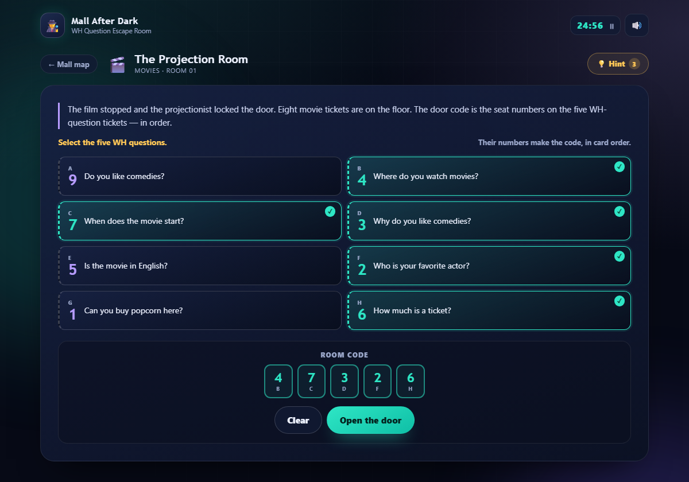

# 🌙 Mall After Dark · WH Question Escape Room

An **English-only** escape room for **A1.2** students. Teams solve four rooms, find the five-digit code hidden among WH questions, complete a chain of speaking questions, and escape the mall before the film starts.

**▶ Play online:** <https://juseprada96.github.io/EnglishActivities/>



- Static site: HTML + CSS + JavaScript. No build, no dependencies.
- Ready for **GitHub Pages**, a classroom laptop, or offline play.
- 4 rooms · 4 five-digit codes · 8 question cards per room · up to 5 named team members · 3 hints.
- Designed for **team play and speaking**, not solo clicking.

---

## How the game works

Each room contains **eight question tickets**. Exactly **five are WH questions**; the other three are **Yes/No questions** and act as decoys.

- Every ticket has a number.
- The room code is made from the numbers on the **five WH questions, in card order**.
- Select five tickets; their numbers appear in the code panel.
- Enter the correct code to open the door.
- Then complete the **question chain** to unlock the next room:
  - Each team member asks one of the five decoded questions to the next member.
  - The next member answers in English, then asks their own question, and so on.
  - With five members: 1 → 2 → 3 → 4 → 5 → 1. With fewer members, the questions cycle.
- The teacher ticks each question only after hearing it asked and answered.
- Clear all four rooms and click the exit to win.

The start screen stores the **team name** and the names of **up to five members**. Those names appear in every question chain, so the teacher can follow who asks what.

Rules and scoring:

- Choose **25 minutes** or **no timer** at the start.
- A wrong code costs **20 seconds** (in timed mode).
- You have **3 hints** for the whole escape.
- Final rank depends on hints and wrong codes:
  - 🥇 Gold: 0 hints, 2 or fewer wrong codes
  - 🥈 Silver: up to 2 hints, up to 5 wrong codes
  - 🥉 Bronze: you escaped anyway!
- Progress is saved in the browser. If the page is reloaded, **Continue the escape** restores rooms cleared and hints used.

> The game has no Spanish translations. Instructions, questions, feedback and missions are all in English.

---

## 🔑 Room codes and answer key (teacher only)

### Room 1 · The Projection Room · Movies

**Code: `47326`**

| WH question | Number |
| --- | --- |
| Where do you watch movies? | 4 |
| When does the movie start? | 7 |
| Why do you like comedies? | 3 |
| Who is your favorite actor? | 2 |
| How much is a ticket? | 6 |

Decoys: *Do you like comedies?* (9) · *Is the movie in English?* (5) · *Can you buy popcorn here?* (1)

### Room 2 · The Music Store · Music

**Code: `84539`**

| WH question | Number |
| --- | --- |
| What kind of music do you like? | 8 |
| Where do you listen to music? | 4 |
| Who is your favorite singer? | 5 |
| When do you listen to music? | 3 |
| How do you listen to music? | 9 |

Decoys: *Can you play the guitar?* (2) · *Are you a good singer?* (6) · *Do you sing in the shower?* (1)

### Room 3 · The Bank Vault · Bank & money

**Code: `69472`**

| WH question | Number |
| --- | --- |
| Where is the nearest bank? | 6 |
| Why do you need the money? | 9 |
| When does the bank open? | 4 |
| How much money do you need? | 7 |
| Who works at the bank? | 2 |

Decoys: *Do you have a credit card?* (3) · *Is there an ATM near here?* (8) · *Can I pay with my phone?* (5)

### Room 4 · The Food Court · Food & drinks

**Code: `93845`**

| WH question | Number |
| --- | --- |
| What do you eat for breakfast? | 9 |
| How many eggs do you need? | 3 |
| Who cooks dinner at home? | 8 |
| Why don't you eat meat? | 4 |
| Which drink is cold? | 5 |

Decoys: *Is the soup hot?* (1) · *Do you want a glass of water?* (7) · *Are you ready to order?* (2)

---

## 👩‍🏫 Using it in class

**Recommended: 25–30 minutes, teams of 3–5, one device per team.**

1. **Set the scene:** the mall is locked, the film starts soon, and the only way out is the four five-digit codes.
2. **Enter the team details:** write the team name and each member's name (up to five) before starting.
3. **Give each student a role:**
   - **Reader** — reads the tickets aloud in English.
   - **Scribe** — selects tickets and enters the code.
   - **Speaker** — leads the question chain and reports the team's answers.
   - **Timekeeper** — watches the clock and decides when to use a hint.
4. **Teacher role:** circulate, listen to the question chain, and tick each question only after hearing it asked and answered. The game does not record audio.
5. **No Spanish:** encourage students to use English, gestures and the question words on the tickets. If a team is stuck, give an English example rather than a translation.
6. **Debrief:** each team writes two new questions with *Where / When / Why / How much* and asks another team.

Projector option: one screen for the whole class, students vote on which five tickets to select, one "captain" clicks, and the teacher ticks each question in the chain.

---

## 🚀 Publish on GitHub Pages

1. Upload these files to the root of a GitHub repository:

   ```
   index.html
   styles.css
   app.js
   escape-data.js
   screenshot.png   (optional, only for this README)
   ```

2. From the project folder:

   ```bash
   git add .
   git commit -m "Add Mall After Dark escape room"
   git branch -M main
   git remote add origin https://github.com/YOUR-USER/YOUR-REPO.git
   git push -u origin main
   ```

3. In GitHub: **Settings → Pages → Source: Deploy from a branch → `main` / `(root)` → Save**.
4. Your game will be at `https://YOUR-USER.github.io/YOUR-REPO/`.

There is no build step, backend or Jekyll setup. You can also double-click `index.html` to play offline.

---

## ✏️ Customizing

All game content is in **`escape-data.js`**. Each room looks like this:

```js
{
  id: "cinema",
  title: "The Projection Room",
  topic: "Movies",
  intro: "...",
  hint: "...",
  code: "47326",
  cards: [
    { q: "Do you like comedies?", n: "9", wh: false },
    { q: "Where do you watch movies?", n: "4", wh: true },
    { q: "When does the movie start?", n: "7", wh: true },
    // ...
  ],
  mission: {
    title: "Team mission · Question chain",
    intro: "..."
  }
}
```

To edit a room:

- Use **eight cards**: exactly **five** with `wh: true` and three with `wh: false`.
- Give every card a **single unique digit** in `n`.
- Set `code` to the five WH numbers **in the order the cards appear**.
- Keep the three Yes/No cards as decoys.
- The room intro and hint can mention the theme, but do not reveal which cards are WH.
- The chain automatically uses the five WH questions and the member names entered at the start. With fewer than five names, it cycles through the members.

Other tweaks in **`app.js`**:

- `HINTS_TOTAL = 3` — number of hints.
- `PENALTY = 20` — seconds lost for a wrong code.
- `timerMode: 25` in the initial `state` — default timer length (also update the start-screen buttons in `index.html`).

The room order is the order of the array in `escape-data.js`. Rooms unlock one at a time.

---

## 📁 Files

| File | Purpose |
| --- | --- |
| `index.html` | Start screen, map, room screen, mission modal, win screen |
| `styles.css` | Night-time escape-room theme and responsive layout |
| `app.js` | Game engine: codes, question chain, timer, hints, saving, ranking |
| `escape-data.js` | All four rooms: questions, numbers, codes, hints, chain intro |
| `screenshot.png` | Preview image for this README |

---

## 🛠️ Technology

HTML, CSS and JavaScript with no external libraries. Sounds are generated with the Web Audio API, progress is stored in `localStorage`, and the layout is responsive for laptops, tablets and phones.
